  

  
  
  
  

  
  
  
  
  

## 👋 About me

I'm a **Cloud & AI Security Architect**, **Ph.D. in Informatics and Knowledge Management** and **university professor** based in São Paulo, Brazil.

- 🔐 **Cloud security** across AWS, Azure, GCP, Huawei Cloud and OCI: IaC, IAM, Zero Trust, guardrails, CNAPP/CSPM and DevSecOps
- 🤖 **AI security**: controls and guardrails for LLMs, AI agents, RAG and enterprise copilots
- 🕵️ **Fraud prevention & OSINT**: machine learning for fraud detection and automated collection of exposed data
- 🔎 **Research**: AI applied to security, OSINT, Google dorks with NLP, anomaly detection and digital forensics
- 🎓 **Teaching**: professor at UNINOVE and guest professor in the Data Engineering MBA at Mackenzie

  
  
  
  

## 🛠️ Tech & security stack

**☁️ Cloud**

  
  
  
  
  

**🔐 Security**

  
  
  
  
  
  

**🤖 AI & data**

  
  
  
  
  

**⚙️ Automation & DevSecOps**

  
  
  
  
  
  

## 🏅 Certifications

ISO/IEC 27001, 42001 and 27701 **Lead Auditor** · **Fellow** of Management Systems Auditing · AI & LLM security (CAISR, CLLMSE, CLLMSP) · Fortinet Certified Associate in Cybersecurity

## 📚 Selected research

| Year | Publication | Venue |
|:---:|---|---|
| 2026 | [Credit card fraud detection: a comparison of intelligent techniques based on cost function evaluation](https://doi.org/10.33448/rsd-v15i8.51608) | Research, Society and Development |
| 2023 | [Google Hacking Database attributes enrichment and conversion to enable the application of machine learning techniques](https://doi.org/10.17485/IJST/V16I42.1799) | Indian Journal of Science and Technology |
| 2023 | OSINT approach with Kohonen self-organizing maps and NLP for automatic execution of dorks | RISTI |
| 2020 | [Systematic literature review to investigate the application of OSINT with artificial intelligence](https://doi.org/10.1080/19361610.2020.1761737) | Journal of Applied Security Research |
| 2019 | [Classification of web history tools through web analysis](https://doi.org/10.1007/978-3-030-22351-9_18) | Lecture Notes in Computer Science (Springer) |

🧾 **Software registration:** DOSNLP – Dork Segmentation with NLP (INPI, BR512023002100-8)

## 📌 Featured repositories

  
  

  
  

## 🚀 Currently

- 🧪 Studying adversarial AI security, AI red & blue teaming and RAG/LLM security
- ☁️ Preparing for the AWS Certified Developer – Associate
- ✍️ Writing about cloud and AI security on [LinkedIn](https://www.linkedin.com/in/jrafa1607/)

  
   
  Made with 💜 · palette: <code>#0d1124</code> <code>#46e3ff</code> <code>#9b6bff</code> <code>#ff4fd8</code> <code>#ff8a3d</code>

